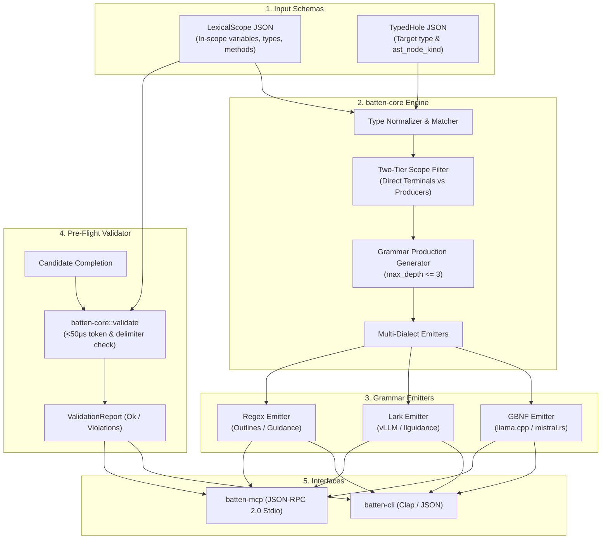

# System Architecture — `batten`

> **Crates:** `batten`, `batten-core`, `batten-cli`, `batten-mcp`  
> **Output Formats:** GBNF (llama.cpp/mistral.rs), Lark EBNF (llguidance/vLLM), Bounded Regex  
> **Latency:** Microsecond Grammar Compilation & Pre-Flight Validation

---

## 1. System Overview & Dataflow

`batten` is the dynamic scope-to-grammar compiler of the `gaugeblock` neurosymbolic suite. It takes a `LexicalScope` (extracted by `miter`) and a `TypedHole` (defined by `dado`), filters available symbols by semantic type compatibility, and emits strict Context-Free Grammars that constrain LLM token decoding to mathematically valid identifiers.



---

## 2. Two-Tier Scope Classification Architecture

`batten` partitions accessible lexical symbols into two tiers to prevent runaway recursive grammar explosions:

```text
LexicalScope Symbols
       │
       ├── Direct Terminals (Tier 1):
       │   - Exact type matches (e.g. `user_id: String` when `String` expected)
       │   - Automatic unwrap matches (e.g. `res: Result<T, E>` -> `res?`)
       │   - Automatic await matches (e.g. `fut: Future<Output=T>` -> `fut.await`)
       │   - Literal constants (if allow_literals is true)
       │
       └── Producer Chains (Tier 2):
           - Functions and methods returning the target type (e.g. `repo.find_by_id(id)`)
           - Limited to single or double-hop argument application
           - Filtered strictly by depth bounds (`max_depth = 3`)
```

---

## 3. Crate & Package Topology

### `batten`
- **Path:** Root package (`src/lib.rs`)
- **Role:** Facade library crate re-exporting `batten-core` compilers, validators, and error types.

### `batten-core`
- **Path:** `crates/batten-core`
- **Role:** Pure domain engine. Contains type normalizers, lexical scope filters, GBNF/Lark/Regex grammar emitters, and the microsecond pre-flight validator. Contains zero CLI or network dependencies.

### `batten-cli`
- **Path:** `crates/batten-cli`
- **Role:** Command-line binary (`batten`). Dispatches `compile`, `validate`, and `inspect` commands with terminal or `--json` outputs.

### `batten-mcp`
- **Path:** `crates/batten-mcp`
- **Role:** Model Context Protocol stdio server. Exposes `batten_compile` and `batten_validate` to AI agents.
