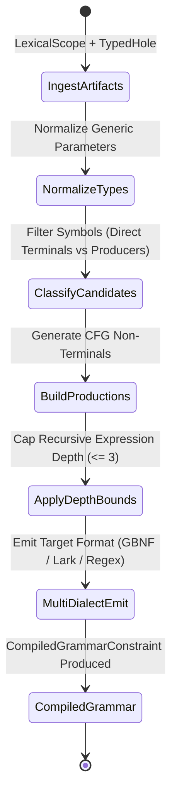
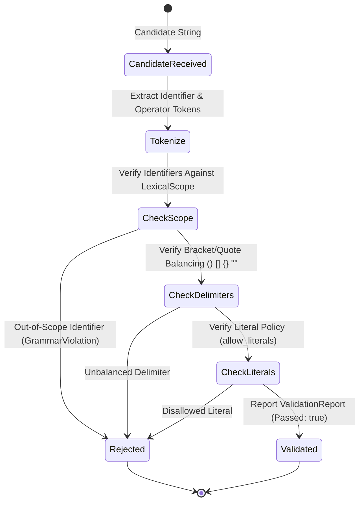

# Behavioral Specifications & Invariants — `batten`

> **Crates:** `batten`, `batten-core`, `batten-cli`, `batten-mcp`  
> **Constraint Engine:** Context-Free Grammar (CFG) Compiler  
> **Schema Version:** `1.0`

---

## 1. Core Behavioral Invariants

### Invariant 1: Lexical Scope Closure Invariant
* Every symbol terminal emitted in a generated grammar constraint must exist in the provided `LexicalScope` or represent a recognized primitive constant or keyword.
* The model physically cannot emit undeclared identifiers or out-of-scope variables under a constrained sampler.

### Invariant 2: Bounded Derivation Depth
* Grammar production rules restrict recursive expression depth to `max_depth` (default: 3).
* When depth reaches `max_depth`, only `DirectTerminal` symbols (variables, fields, constants) are permitted, preventing runaway recursion loops.

### Invariant 3: Microsecond Pre-Flight Validation
* `batten validate` evaluates candidates using token-membership hashing and balanced delimiter counters.
* The pre-flight validator executes in `<50μs` with zero subprocess spawning and zero disk I/O.

### Invariant 4: Tri-Format Semantic Equivalence
* The compiler maintains a neutral intermediate representation of grammar productions.
* Emitters for GBNF (llama.cpp/mistral.rs), Lark (vLLM/llguidance/outlines), and Regex recognize the exact same token languages.

---

## 2. System State Machines

### 2.1 Scope-to-Grammar Compilation Pipeline

### 2.2 Pre-Flight Candidate Validation Pipeline

---

## 3. Formal Type Contracts

### Boundary Models, Wire Types & Enums

- **`error::BattenError`** (`enum`): Master error enum for scope parsing, type normalization, and grammar generation.
- **`model::CandidateClassification`** (`enum`): Two-tier classification of a symbol candidate (`DirectTerminal`, `ProducerChain`, `Rejected`).
- **`args::Cli`** (`struct`): Root command-line parser definition for `batten-cli`.
- **`args::Command`** (`enum`): Top-level CLI subcommands (`Compile`, `Validate`, `Inspect`, `Mcp`).
- **`model::CompiledGrammarConstraint`** (`struct`): Output artifact containing the grammar text, format, allowed terminals, and metadata.
- **`tokens::ExtractedTokens`** (`struct`): Tokenized representation of a candidate fill for pre-flight checking.
- **`model::FilteredScope`** (`struct`): Categorized symbols partitioned into direct terminals and producer chains for a typed hole.
- **`args::FormatArg`** (`enum`): CLI argument format choice (`Gbnf`, `Lark`, `Regex`).
- **`mod::GrammarConfig`** (`struct`): Configuration parameters controlling recursion depth, literal allowance, and formats.
- **`model::GrammarFormat`** (`enum`): Supported grammar dialects across the suite (`Gbnf`, `Lark`, `Regex`).
- **`mod::GrammarViolation`** (`enum`): Discrete violation flagged by pre-flight validation (e.g. `OutOfScopeIdentifier`, `UnbalancedDelimiter`).
- **`model::LexicalScope`** (`struct`): In-scope bindings, imports, and variables at an AST hole location.
- **`model::ScopeCandidate`** (`struct`): Evaluated candidate symbol with its type relationship to the target hole.
- **`model::ScopeSymbolKind`** (`enum`): Symbol kind in scope (`Variable`, `Function`, `Method`, `Type`, `Constant`).
- **`model::SymbolBinding`** (`struct`): Discrete symbol binding recording identifier, type string, and visibility.
- **`type_norm::TypeMatch`** (`enum`): Semantic rating between a symbol's return type and the hole (`Exact`, `UnwrapResult`, `AwaitFuture`, `Mismatch`).
- **`mod::ValidationReport`** (`struct`): Comprehensive report detailing candidate validation outcome, violations, and token counts.
